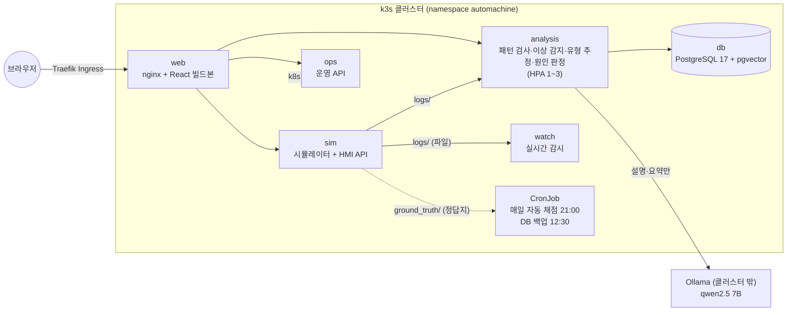

# automachine — 가상 디스펜싱 장비와 AI 로그 분석

스마트폰 조립 라인의 **디스펜싱(접착제 도포) 셀**을 Python으로 시뮬레이션하고, 장비가 남긴 로그로
**고장을 알람보다 먼저 알아채고 원인을 말해 주는 AI**를 만든 프로젝트입니다.

- **출제자(시뮬레이터)**: 실제 장비처럼 로그를 남기고, 숨겨진 고장 9종을 주입하며, 정답지를 따로 기록합니다.
- **탐정(analysis)**: 로그만 보고 고장을 찾습니다. 정답지는 볼 수 없습니다.
- **채점자(eval)**: 탐정의 답을 정답지와 비교합니다. 채점 기준은 결과를 보기 전에 정했습니다.

핵심 원칙은 **"판단은 코드가, 설명은 LLM이"** 입니다. 로컬 LLM에게 원인 판단을 맡겨 본 실험에서
규칙과 결정 트리보다 못했기 때문에, 원인은 코드가 정하고 LLM은 근거 설명과 교대 인수인계 요약만 맡습니다.

## 화면

| 탭 | 내용 |
|---|---|
| HMI | 장비 앞 터치 화면 흉내: 메인, 시퀀스, 수동, I/O, 알람, 로그, 생산, 레시피, 유지보수, 설정(운전 방식·장비 설정·화면, 한국어/English) |
| 엔지니어 콘솔 | 시뮬레이터 도구: 고장 주입, 숨겨진 물리 상태, 안전 도어 같은 현장 조작 |
| 3D 뷰어 | 장비가 실제 스텝에 맞춰 움직이는 3D 장면 |
| AI 분석 | 처음 보는 사람용 용어 안내, 실시간 감시 띠, 지난 런 분석(패턴 검사·이상 감지·유형 추정), 이상 건마다 쉬운 말 요약·원인 판정·압력·진공 그래프·원인 분석 보고서, 교대 인수인계 |
| 운영 | k8s 서비스 상태, 파드 죽이기, 재시작·되돌리기, 자동 확장 부하 시험, 요청 지표, 백업, 자동 채점 결과 |

시뮬레이터와 HMI의 자세한 사용법, 고장 시나리오, 출력 파일은 [docs/simulator.md](docs/simulator.md)에 있습니다.
부품과 장비 설명서(가상 제조사 형식)는 [docs/manual/devices/](docs/manual/devices/)에 있습니다.

## 구조



- analysis와 watch는 `logs/`만 읽습니다. **정답지(`ground_truth/`)는 채점할 때만** 씁니다.
- 개발은 Docker Compose, 배포와 발표는 k3s(Kustomize의 dev / demo 설정)로 합니다.

## AI 구성

화면에는 하는 일을 나타내는 이름을 쓰고, 코드와 실험 기록에는 개발 중에 붙인 별명(괄호)이 남아 있습니다.
사건(incident)은 화면에서 "이상 건"이라고 부릅니다.

| 화면 이름 (별명) | 하는 일 | 방식 | 코드 |
|---|---|---|---|
| 패턴 검사 (규칙 7개) | 아는 고장을 이름까지 맞힘 | dev 런을 보고 정한 조건 (예: 공기 압력과 진공이 함께 떨어짐) | `analysis/app/rules.py` |
| 이상 감지 (경비원) | "정상 범위를 벗어났다"를 알림 (이름은 모름) | 정상 구간만 배운 z-score, 값 5개 | `analysis/app/anomaly.py` |
| 유형 추정 (분류) | 이상 감지가 울린 사건에 이름 붙이기 | 결정 트리 (깊이 8) | `analysis/app/classify.py` |
| 원인 판정 (반장의 코드 판단) | 경보를 이상 건으로 묶고 원인을 정함 | 코드 (규칙 첫 이름 → 청소 뒤 폭 회복 여부 → 트리) | `analysis/app/foreman.py` |
| 원인 분석 보고서 (반장 보고서) | 근거·반대 근거 문장, 조치 안내 | 로컬 LLM + 함수 호출 + 설명서 검색(RAG). 숫자는 코드가 출처를 검사 | `analysis/app/foreman.py`, `manual.py` |
| 실시간 감시 | 돌고 있는 장비 로그를 1초마다 읽어 경보 | 위의 네 가지를 그대로 사용 | `analysis/app/live.py`, `watch.py` |
| 교대 인수인계 | 교대 동안의 알람·정비·AI 경보·설정 변경 정리 | 사실 목록은 코드, 3문장 요약과 할 일은 LLM (빠지거나 지어낸 숫자를 코드가 검사) | `analysis/app/handover.py` |

## 점수표

**읽는 법**
- 런은 **dev**(만들고 고칠 때 보는 것)와 **test**(다 만든 뒤 한 번만 채점, 11/2)로 나눴습니다. test를 보고 고친 점수는 쓰지 않습니다.
- 탐지는 고장 시작부터 60분(장비가 돌던 시간 기준) 안에 맞혀야 정답입니다. 자세한 기준은 [eval/README.md](eval/README.md)에 있습니다.
- 시뮬레이터에서 만든 데이터라 실제 장비 성능을 보장하지 않습니다. 같은 출제자가 만든 고장이라 규칙이 유리합니다.

### 1. 고장 탐지 (test 11런, 고장 13개)

| 방법 | 고장 이름 | 탐지 | 지연 중앙값 | 오탐 |
|---|---|---|---|---|
| 규칙 7개 | 맞혀야 정답 | **12/13** (92%) | 4분 | 1 |
| 경비원 | 안 봄 | **13/13** (100%) | 4분 | 3 |
| 경비원 + 분류 | 맞혀야 정답 | 13/13 (100%) | 4분 | 10 |

규칙이 놓친 1건은 온도 센서 드리프트(표시 온도는 정상이라 노즐 막힘으로 보임)입니다.

### 2. 처음 보는 고장

고장마다 그 고장의 규칙을 빼고 채점했습니다. 경비원은 정상만 배우므로 처음 보는 고장도 잡습니다.

| 런 | 규칙 (자기 규칙 빼면) | 경비원 |
|---|---|---|
| test | 1/13 | **13/13** |
| dev (경비원은 그 런을 빼고 배움) | 4/31 (13%) | **26/31** (84%) |

### 3. 원인 판단 (test 사건 16개)

반장은 런 전체를 볼 수 있어서(예: 청소 뒤 결과) 탐지 표와 섞지 않고 사건별로 따로 쟀습니다.

| 판단 | 맞힘 |
|---|---|
| 규칙의 첫 이름 | 14/16 |
| 분류 트리 | 13/16 |
| **코드 판단 (제품에 쓰는 것)** | **13/16** |
| 클라우드 LLM `claude-opus-5-5` (비교용) | 14/16 |

dev에서는 코드 판단이 35/36이었지만 dev를 보고 만든 기준이라 낙관적입니다.

### 4. LLM에게 맡길 일 찾기

| 실험 | 결과 | 결론 |
|---|---|---|
| 원인 이름 고르기 (dev 36사건) | 로컬 `qwen2.5` 29, `hermes3` 13/35, 클라우드 `claude-opus-5-5` 34 / 규칙 30, 코드 판단 35 | 로컬 모델에 판단을 맡기지 않음 |
| 규칙이 없는 고장에 이름 붙이기 (dev 24사건) | 고장 목록 있음 9/24, 목록 없이 부품 설명서로 추론 0/24 / 같은 사건 결정 트리 20/24. 틀린 답 대부분이 "확신 높음" | 판단은 코드로 |
| 설명 품질 (test 16사건) | 좋은 설명 14/16 (숫자 출처·주제·핵심 단서·순서·방향 검사). 판단이 틀린 사건 3개에서 의문 제기 0 | 설명은 쓸 만하지만 틀린 판단을 잡아 주지는 못함 |
| 교대 인수인계 요약 (test 1회) | 꼭 담을 사실 12/14, 지어낸 숫자 0/11, 이어 볼 일 1/1 | 제품에 넣음 (AI 분석 탭) |

### 5. 실시간 감시: 알람보다 먼저

| 시험 | 결과 |
|---|---|
| 재생 시험 (dev 4런, 사건 8개) | 관련 설비 알람보다 **2~55분 먼저** |
| 실제 고장 주입 (11/4, 노즐 막힘) | AI 경보 10:36:57 → 설비 알람 E3005 11:25:00, **48분 먼저** |

장비가 멈추면(점심 정지 등) 고장이 진행되지 않아 앞선 시간이 짧아집니다. 11/3 시험은 3.9분, 5.4분이었습니다.

### 6. 매일 자동 채점

k8s CronJob이 매일 21:00에 처음 보는 시드로 런 3개를 만들어 채점하고 `scores/auto_날짜.json`에 남깁니다. 운영 탭에서 볼 수 있습니다.

| 날짜 | 규칙 탐지 | 경비원 탐지 | 원인 (코드 판단) |
|---|---|---|---|
| 11/3 | 3/3 | 3/3 | 3/3 |
| 11/4 | 4/5 (니들 위치 1건 놓침) | 4/5, 오탐 1 | 3/4 |

### 한계

- 온도 센서 드리프트는 청소 뒤 비드 폭이 돌아오는지로 가르는데, 이 기준을 dev 2건으로 정했고 test에서 빗나갔습니다.
- 실시간 판단은 그 시점까지의 기록만 쓰므로 온도 센서는 청소 뒤에야 가려집니다.
- 처음 보는 제품(레시피 B)은 경비원이 평소 모습을 모릅니다.
- LLM은 틀린 판단을 그럴듯하게 설명할 뿐 의문을 제기하지 못했습니다.

## 실행

### k3s (배포·발표)

WSL Ubuntu에 k3s와 Docker가 있어야 합니다. 처음 설정, 켜고 끄기, 버전 되돌리기, 운영 화면, 자동 채점은 [k8s/README.md](k8s/README.md)를 보세요.

```bash
sudo systemctl start k3s     # 켜기
bash k8s/deploy.sh           # 이미지 빌드 후 배포 (dev). 발표용은 bash k8s/deploy.sh demo
```

http://localhost 에서 모든 탭이 열립니다. 이 PC는 메모리가 8GB라 k3s를 쓸 때 다른 Compose 프로젝트는 끕니다.

### Docker Compose (개발)

```bash
cp .env.example .env              # DB_PASS 입력
docker compose up --build
```

web http://localhost:5174, sim 8100, analysis 8101, db 5433. 자세한 내용은 [docs/simulator.md](docs/simulator.md)의 "Docker로 실행"에 있습니다.

### 시뮬레이터만

```bash
python run_sim.py config/scenarios/nozzle_clog.json   # 8시간 가동, 약 2초
python -m unittest -v                                  # 테스트
```

### 채점

```bash
python eval/score.py --split dev            # 규칙 탐지 점수
python3 eval/compare.py                     # 규칙·경비원·분류 비교표
python3 eval/score_foreman.py               # 사건별 원인 판단 (LLM 보고서는 --reports N)
```

k8s에서 돌리는 방법은 [eval/README.md](eval/README.md)에 있습니다.

## 폴더 구조

```
config/          장비 설정, 시나리오
simulator/       시뮬레이터 (물리, 센서, 스테이션, 작업자, 운전 방식·장비 설정)
faults/          고장 엔진과 고장 9종
server/          시뮬레이터 실시간 서버 (FastAPI, REST + WebSocket)
web/             React 19 + Vite 8 (HMI, 엔지니어 콘솔, 3D 뷰어, AI 분석, 운영), 한국어/English
analysis/        AI 로그 분석 (규칙, 경비원, 분류, 반장, 실시간 감시, 인수인계, 설명서 검색)
ops/             운영 API (k8s API로 상태·조작)
eval/            채점 기준과 채점 코드, eval/explore/ 실험 스크립트
k8s/             k3s 배포 설정 (Kustomize), 배포 스크립트
db/              PostgreSQL 스키마와 변경 파일
docs/            시뮬레이터 상세, 부품·장비 설명서
tests/           시뮬레이터·서버 테스트 (analysis/tests는 분석 테스트)
```
